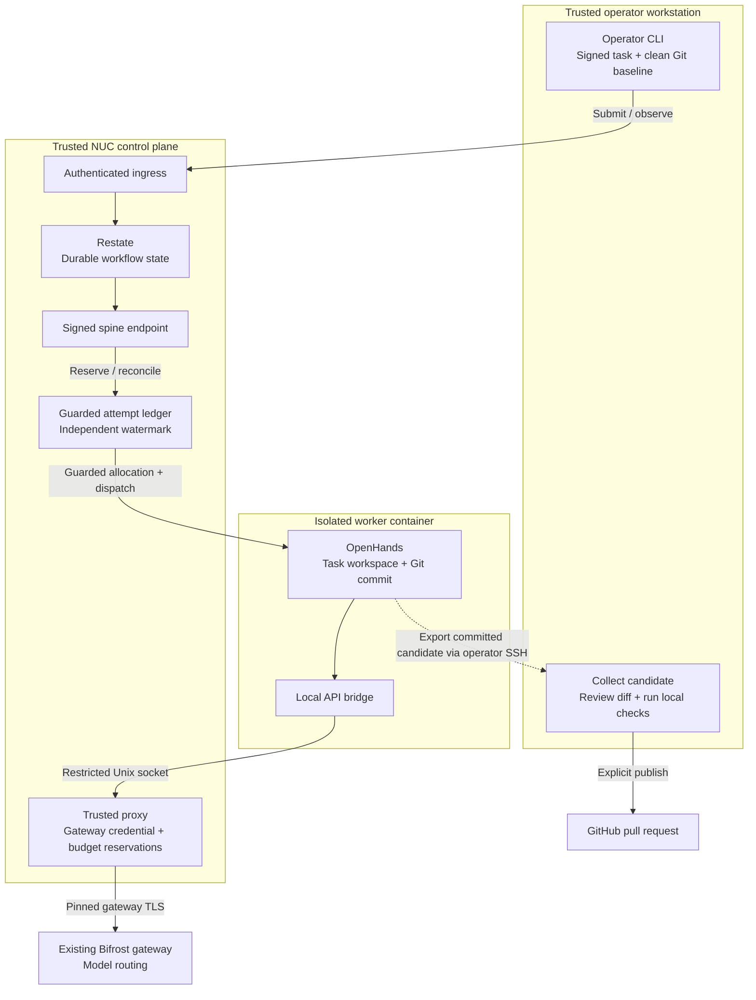
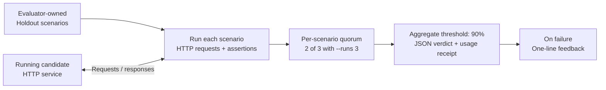
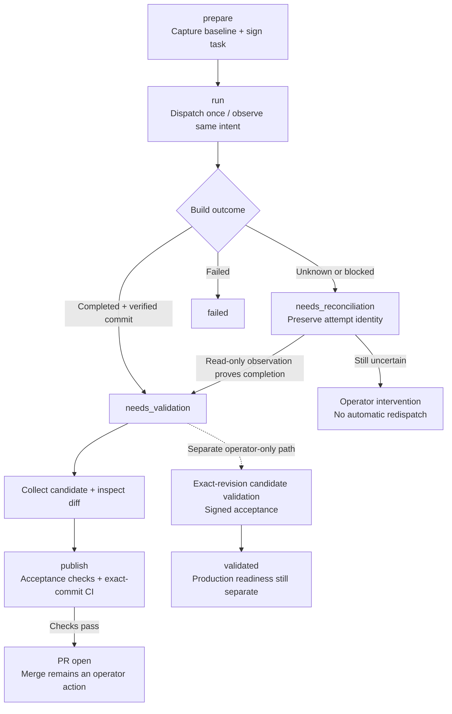
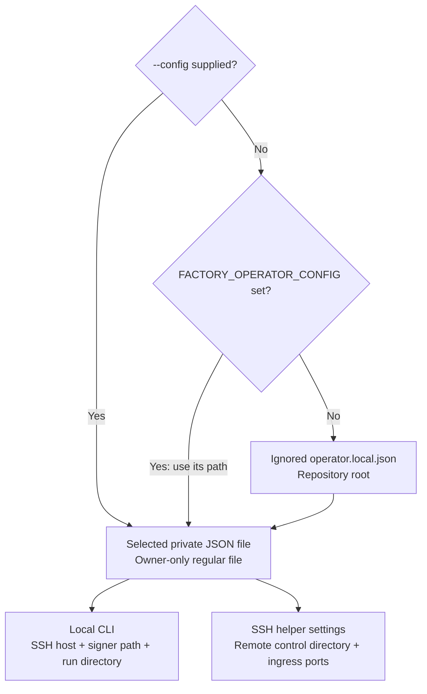

# Software Factory Stapled

A software-factory prototype combining **OpenHands** for code generation,
**Restate** for durable orchestration, and an existing **Bifrost** gateway for
model access. Python components provide holdout evaluation, security checks,
guarded attempt accounting, and an operator-controlled task-to-pull-request workflow.

Start with the local tests and evaluator demo below. They require no model
credentials, remote worker, or paid API calls. Real generation requires
separately provisioned infrastructure and operator approval.

## Contents

- [Capabilities and limits](#capabilities-and-limits)
- [Architecture](#architecture)
- [Local setup](#local-setup)
- [Evaluator demo](#evaluator-demo)
- [Example application](#example-application)
- [Verification and security scanning](#verification-and-security-scanning)
- [Real worker operation](#real-worker-operation)
- [Configuration](#configuration)
- [Troubleshooting and recovery](#troubleshooting-and-recovery)
- [Contributing](#contributing)
- [Documentation](#documentation)

## Capabilities and limits

This is a sandbox-scoped system under active development. Cloning it does not
install or enable a complete hosted factory.

| Component | Available behavior | Boundary |
| --- | --- | --- |
| Holdout evaluator (“the wall”) | HTTP acceptance scenarios, quorum, aggregate threshold, JSON verdict and receipt | Standalone demo; real holdouts must stay outside the generator workspace |
| Security primitives | Operation classification, scoped credential tokens, scanner integration | OpenHands terminal operations are not all mediated by the standalone guard |
| Restate spine | Durable work units, persisted attempt identity, build orchestration and reconciliation | Builds stop at `needs_validation`; no automatic wall evaluation, merge, or deployment from this workflow |
| OpenHands runtime | Private operator config, isolated Docker allocation, guarded attempt and budget stores | Missing trusted configuration blocks dispatch; production scope is denied |
| Operator CLI | Sign/prepare a task, run or observe it, collect committed output, check it and publish a PR | Requires the verified NUC deployment; no merge, deployment, or scheduling command |
| Application validation | Separate exact-revision, prebuilt-candidate validation and signed acceptance | Local CI and an open PR do not establish application acceptance or production readiness |

Request admission uses a **$2 best-effort estimated budget**, not a cap on actual
provider charges. Failed or uncertain requests retain reservations. See
[routing and accounting](stapled-factory/worker/ROUTING.md).

Planning documents include earlier experiments and proposed behavior. Use the
implementation and current component runbooks for operational decisions;
historical “merged” demonstrations do not establish automatic merging today.

## Architecture



The boxes identify trust boundaries, not separate physical machines. Worker API
traffic reaches Bifrost through the trusted proxy. Candidate collection uses the
operator's control channel. Application validation, merge, and deployment remain
separate operator actions.

Restate preserves workflow state. The guarded ledger controls attempt reservation
and recovery. An ambiguous result is observed under its original identity rather
than treated as permission to dispatch again. The proxy owns gateway credentials;
the worker receives neither those credentials nor operator signing keys.

```text
stapled-factory/
  operator/       prepare/run/publish/status/abandon CLI
  spine/          TypeScript Restate services, ingress, Python validation helpers
  worker/         OpenHands adapter, Docker provisioning, proxy, ledgers, probes
  wall/           Holdout evaluator, scenarios, correct/broken HTTP fixtures
  security/       Operation firewall, credential broker, scanner pipeline
  deployment/     NUC install, validation, backups, Restate image
  fixtures/       Sample work-package text
scripts/          Local CI and audit utilities
docs/examples/    Runnable applications from factory experiments
docs/verification/ Recorded verification evidence
docs/planning/    Architecture, decisions, plans, historical progress
```

## Local setup

Commands use a POSIX shell and start in the repository root unless indicated.

### Prerequisites

| Tool | Needed for |
| --- | --- |
| Python 3.11+ with `venv` and `pip` | Python tests and components; runtime images use Python 3.11 |
| Node.js 22+ and npm | Spine build/tests; helper scripts use Node type stripping |
| Git | Checkout, revisions, local verification |
| OpenSSL | Signing-related local tests and operator approvals |
| Gitleaks | Full repository verification script |
| Docker on a trusted Linux host | Real worker provisioning and explicit integration probes |
| Restate server | Live orchestration only; deployment image pins Restate 1.8.0 |
| SSH, SCP, authenticated GitHub CLI (`gh`) | Existing NUC operator workflow and PR publication |

Docker, Restate, and gateway credentials are unnecessary for the basic tests and
demo. Python components use the standard library; install `pytest` for the test
suite. OpenHands runs in its worker image, not this local virtual environment.

```sh
git clone https://github.com/swimbo/software-factory-stapled.git
cd software-factory-stapled

python3 -m venv .venv
. .venv/bin/activate
python3 -m pip install pytest

cd stapled-factory/spine
npm ci --ignore-scripts
npm run build
node --test tests/*.test.mjs
cd ../..

cd stapled-factory
python3 -m pytest worker/tests security/tests wall/tests wall/isolation \
  spine/python_tests deployment/nuc -q
cd ..
```

The build creates ignored `stapled-factory/spine/dist/` files. Virtual environments,
Node dependencies, and local CI receipts are also ignored. These checks need no
`.env` file.

## Evaluator demo

The wall evaluates a running candidate through HTTP. Private scenarios and
evaluation results belong to the evaluator side of the boundary:



This standalone evaluator is not automatically called by the current build
workflow. A real candidate requires trusted binding to the exact built revision.

The auth targets are disposable fixtures with hardcoded test credentials and
short session lifetimes. They are not authentication services to deploy for users.

In terminal A, from the repository root:

```sh
python3 stapled-factory/wall/target/app.py
```

In terminal B, also from the repository root:

```sh
python3 stapled-factory/wall/evaluator/cli.py \
  --target http://127.0.0.1:8777 \
  --scenarios stapled-factory/wall/holdout/scenarios.json \
  --config stapled-factory/wall/config.json \
  --tier cheap \
  --runs 3
```

Expect JSON containing `verdict.passed: true`, per-scenario results, and a
`receipt`. Three runs require two successful runs per scenario; the aggregate
threshold is 90%. The CLI defaults to one run if `--runs` is omitted.

Stop terminal A with Ctrl-C, then start the broken fixture in its place. If the
OS has not yet released port 8777, wait briefly before restarting:

```sh
python3 stapled-factory/wall/target/broken_app.py
```

Repeat the evaluator command: expect `verdict.passed: false` and a failure message.
Stop the fixture afterward. **Inspect the JSON verdict and
`receipt.ceiling_violation`; the CLI exit status alone is not a pass/fail gate.**
Receipt estimates do not independently measure provider billing.

The committed scenarios are public demo data. Keep real private holdouts in
evaluator-owned storage outside all worker checkouts and mounts. See the
[wall runbook](stapled-factory/wall/README.md).

## Example application

The [version-endpoint example](docs/examples/version-endpoint/README.md) is a small
HTTP service collected from a real worker experiment. Run it without Docker or
model access:

```sh
cd docs/examples/version-endpoint
python3 -m unittest -v
python3 app.py
```

From another terminal:

```sh
curl -fsS http://127.0.0.1:8777/version
```

Expected JSON: `{"service": "factory-example", "version": "1.0.0"}`.
Stop any wall fixture first: it uses the same port. This example also contains
fixture authentication and is intended for local experimentation.

## Verification and security scanning

For component checks, use the setup commands above. For a narrower edit, select
the relevant suite, for example:

```sh
python3 -m pytest stapled-factory/wall/tests stapled-factory/wall/isolation -q
```

To scan a diff independently of orchestration:

```sh
git diff -- README.md | python3 stapled-factory/security/pipeline_cli.py \
  --paths README.md --target .
```

The report identifies which engines actually ran. Semgrep, Gitleaks, OSV-Scanner,
and Cosign are optional for component exploration; fallback checks do not equal
full scanning or verified provenance. See [security setup](stapled-factory/security/README.md).

### Full local CI before pushing

With the Python environment active and Gitleaks installed on `PATH`:

```sh
python3 scripts/verify-local.py
```

The script clones the local repository into a temporary directory and verifies
**committed `HEAD`**, excluding uncommitted edits. It runs Gitleaks, the Python
suite, locked npm installation, a high-severity npm audit, TypeScript compilation,
and all Node test files. Logs and a machine-readable receipt are stored in
`.local-ci/<revision>/`.

The repository uses operator-run local CI rather than GitHub-hosted runners.
Its documented merge gate is `local-ci/verified` for the exact commit. A receipt
does not itself publish that GitHub status. See [local CI policy](.github/LOCAL_CI.md).

Docker probes in `stapled-factory/worker/probes/` are separate integration
experiments. Read each before running it: prerequisites and resource effects
vary. They are outside the basic quick start.

## Real worker operation

### Provision infrastructure first

The operator CLI reads machine settings from ignored `operator.local.json` at
the repository root. Create it from the portable template, then edit its values:

```sh
cp operator.example.json operator.local.json
chmod 600 operator.local.json
```

Set `ssh_host` to your SSH alias or `user@host`, `control_dir` to the remote
absolute state directory, `signer` to the local private signing-key path, and
`runs_dir` to the local private run directory. Set both ingress ports to match
your deployment. The file must be owned by your user, have no group/other
permissions, and be a regular file rather than a symlink. It contains references,
not key/token contents. The template does not provision keys or infrastructure.

For another config location, use `FACTORY_OPERATOR_CONFIG=/absolute/path/config.json`
or `python3 stapled-factory/operator/cli.py --config /absolute/path/config.json ...`.
The flag takes precedence over the environment variable. Only the default
`operator.local.json` path is automatically ignored; keep custom private configs
outside the repository. Do not change a run's host, state directory, ports, or
signing identity while it is active or uncertain.

To adapt the deployment, review `operator/nuc.py`, provision a trusted
Linux Docker host, install a frozen signed release, and establish independent
operator/image trust roots and a private Bifrost credential reference. Follow:

1. [NUC control-plane installation](stapled-factory/deployment/nuc/README.md).
2. [Runtime images and signed approval](stapled-factory/worker/RUNTIME_IMAGES.md).
3. [Private worker configuration](stapled-factory/worker/OPERATOR_CLI.md).
4. [Gateway routing and reservation policy](stapled-factory/worker/ROUTING.md).
5. [Single-operator workflow](stapled-factory/operator/README.md).

Build and verify releases/images off the deployment host, then transfer immutable
artifacts. The existing deployment does not install packages or build source on
the NUC. The Railway Restate image is an alternative control-plane foundation,
not a complete worker deployment or a drop-in Docker host.

### Prepare, run, review, publish

There are two distinct outcomes after a completed build: publishing a checked
repository change as a PR, and accepting a separately validated application
candidate. One does not imply the other.



Once the deployment is verified, create task JSON with exactly these fields.
Replace the paths and choose a new unique unit:

```json
{
  "unit": "docs-example-001",
  "repo": "/absolute/path/to/clean/repository",
  "baseline": "main",
  "task": "Improve the README installation instructions",
  "acceptance": ["Document prerequisites and a runnable local test command"],
  "allowed_paths": ["README.md"],
  "check_script": "/absolute/path/outside/repository/check_readme.py"
}
```

The source checkout must be clean, have a GitHub origin, and contain the current
remote `main` commit at its named baseline ref. Allowed paths are exact
repository-relative filenames. The operator-owned Python check stays outside
the generator repository, receives the collected candidate directory as its
only argument, and must reject unacceptable results with a nonzero exit status.
The target repository must provide the expected `scripts/verify-local.py` gate;
this is not a generic runner for arbitrary repositories.

```sh
python3 stapled-factory/operator/cli.py prepare /absolute/path/task.json
```

Use the run directory returned by `prepare`:

```sh
python3 stapled-factory/operator/cli.py run /absolute/path/to/run-directory
python3 stapled-factory/operator/cli.py status /absolute/path/to/run-directory
```

`prepare` captures/signs inputs without a model call. `run` dispatches or observes
the original intent, collects a verified committed candidate, and retains
accounting/recovery evidence. The worker has no general network access and must
not install dependencies to make tests run.

**Review `candidate.diff`, source, tests, and dependency changes before publishing.**
This command executes candidate local CI on the operator machine; it is not a
host execution sandbox:

```sh
python3 stapled-factory/operator/cli.py publish /absolute/path/to/run-directory
```

After successful checks, it pushes the completed revision to `codex/<unit>` and
opens or reuses a PR. It does not merge or deploy. A repository-only PR can be
ready for review while Restate remains `needs_validation`, since application
candidate acceptance is separate.

## Configuration

Configuration selection happens locally. Only the remote directory and ingress
ports from the selected file are forwarded in the SSH helper's settings payload:



These settings are not a complete deployment recipe. Private files, ledgers,
images, workspaces, and signed inputs must already exist.

| Variable | Purpose |
| --- | --- |
| `FACTORY_OPERATOR_CONFIG` | Local operator JSON path; defaults to ignored repository-root `operator.local.json`; `--config` overrides it |
| `FACTORY_RESTATE_IDENTITY_KEYS` | Required comma-separated `publickeyv1_...` Restate request identity public keys |
| `FACTORY_ENDPOINT_PORT` | Signed endpoint port; local default `9080` |
| `FACTORY_INGRESS_TOKEN_FILE` | Owner-only regular file with a random base64url bearer token generated from at least 32 random bytes |
| `FACTORY_INGRESS_GATEWAY_PORT` | Bearer gateway port; local default `9081` |
| `FACTORY_RESTATE_INGRESS_PORT` | Gateway upstream ingress port; local default `8080` |
| `FACTORY_RUNTIME_CONFIG` | Operator-owned mode-`0600` per-attempt runtime JSON |
| `FACTORY_ATTEMPT_DB`, `FACTORY_ATTEMPT_ANCHOR` | Separate absolute paths for guarded attempt state and its independent watermark |
| `FACTORY_GATEWAY_KEY_FILE` | Optional owner-only gateway credential file reference; contents stay outside the worker |
| `FACTORY_IMAGE_APPROVAL_KEY` | Independently provisioned image-approval public trust root |

After building, the endpoint runs with `npm start` from `stapled-factory/spine/`;
the optional gateway runs there with `node dist/ingress_main.js`. Starting either
does not create/register Restate or provision a worker. Missing or malformed
identity configuration prevents endpoint startup.

| Listener | Local default | Documented NUC installation |
| --- | --- | --- |
| Restate raw ingress | `8080` | `18080` |
| Restate admin | `9070` | `19070` |
| Signed spine endpoint | `9080` | `19080` |
| Bearer ingress gateway | `9081` | `19081` |
| Demo HTTP target | `8777` | Disposable candidate-specific |

Keep raw ingress, admin, and internal listeners isolated from untrusted clients.
Request signing authenticates Restate to the endpoint; it does not authorize
Restate ingress callers. Loopback does not isolate other local processes. The
bearer gateway exposes a narrow POST allowlist rather than the full admin API.
Legacy `npm run invoke`/`approve` scripts are raw-ingress development helpers,
not the bearer-authenticated operator workflow.

Never commit credentials, private keys, runtime configurations, or live state.
Preserve ledgers and their independent anchors. The local pair cannot detect a
coordinated rollback of both files.

## Troubleshooting and recovery

| Symptom | Action |
| --- | --- |
| Cannot import `pytest` | Activate `.venv`; install with that environment's `python3 -m pip` |
| Node/build errors after checkout | Use Node 22+, run `npm ci --ignore-scripts` in `stapled-factory/spine/`, then rebuild |
| Target unreachable or port occupied | Start the intended fixture; only one demo can bind `127.0.0.1:8777` |
| Evaluator exits successfully despite failures | Read `verdict.passed` and the receipt; process success only means a result was produced |
| Endpoint rejects startup or unsigned requests | Check public identity keys and signed-server setup; retain identity verification |
| Bearer ingress returns `401` or `404` | Check authentication, allowlisted route, POST method, and exact `application/json` content type |
| Worker reports `blocked` | Check trusted config, permissions, image approval, guarded stores, and sandbox scope |
| `needs_reconciliation` or `NEEDS_INTERVENTION` | Preserve original identity/state and use documented observation; do not bypass uncertainty with another unit |
| Completed build stays at `needs_validation` | Expected until separate application-candidate validation accepts the exact revision |
| Full CI stops | Inspect `.local-ci/<revision>/receipt.json` and its step logs; check Gitleaks and registry/audit access |
| Store quarantined | Preserve store and anchor; do not reset them or restore an older snapshot to resume |

Do not delete active operator markers, reset budgets, or redispatch uncertain
attempts. For an already safely fenced attempt, signed abandonment retains
evidence without refunding spend or declaring success. Follow
[abandonment instructions](stapled-factory/operator/README.md#close-an-already-fenced-attempt),
[recovery operations](stapled-factory/worker/RECOVERY_OPERATIONS.md), and
[NUC cold backup](stapled-factory/deployment/nuc/BACKUP.md).

## Contributing

1. Create a focused branch, conventionally `codex/<description>`.
2. Update relevant component documentation with behavior changes.
3. Run relevant component checks and `git diff --check`.
4. Commit intended files, then run `python3 scripts/verify-local.py` against that
   exact commit before pushing.
5. Push and open a PR. Follow [local CI policy](.github/LOCAL_CI.md) for the exact-SHA
   `local-ci/verified` status and the [PR template](.github/PULL_REQUEST_TEMPLATE.md).

Passing tests do not establish live isolation, publisher provenance, recovery,
application acceptance, or a provider billing ceiling. Record which boundaries
any runtime experiment actually exercised.

## Documentation

| Topic | Read |
| --- | --- |
| Operator workflow | [Operator README](stapled-factory/operator/README.md) |
| Restate services and ingress | [Spine README](stapled-factory/spine/README.md) |
| Exact-revision validation | [Validation binding](stapled-factory/spine/VALIDATION_BINDING.md) |
| Worker boundaries | [Worker README](stapled-factory/worker/README.md), [private configuration](stapled-factory/worker/OPERATOR_CLI.md) |
| Runtime image trust | [Runtime images](stapled-factory/worker/RUNTIME_IMAGES.md) |
| Budget witness | [Independent budget witness](stapled-factory/worker/BUDGET_WITNESS.md) |
| Evaluation | [Wall README](stapled-factory/wall/README.md) |
| Security | [Security README](stapled-factory/security/README.md) |
| Deployment | [NUC](stapled-factory/deployment/nuc/README.md), [private Railway Restate](stapled-factory/deployment/restate/README.md) |
| Design | [Architecture](docs/planning/stapled-factory/architecture.md), [consensus](docs/planning/stapled-factory/consensus-plan.md), [decisions](docs/planning/stapled-factory/decisions/INDEX.md) |
| Plans and history | [Phased plan](docs/planning/stapled-factory/phased-plan.md), [progress](docs/planning/stapled-factory/progress.md), [verification records](docs/verification/) |
| Background | [Research report](dark-software-factory-report.md) |

This project split from the earlier `software-factory` project on October 26,
2026 and has an independent baseline. The release remote is
[swimbo/software-factory-stapled](https://github.com/swimbo/software-factory-stapled).
No license file is currently included; no open-source license grant is stated.
